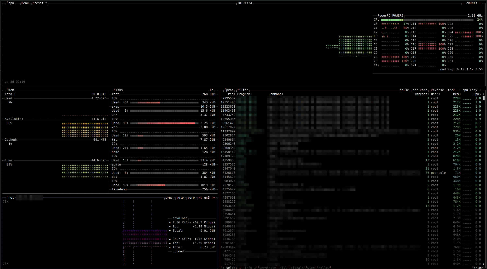

# btop on IBM AIX

Patches that port [btop](https://github.com/aristocratos/btop) (resource monitor for the
terminal) to IBM AIX, and a ready-to-install package for AIX 6.1 TL7 up to 7.3.



| Where | Content |
|---|---|
| [Releases](https://github.com/mawelo/aix-btop/releases) | `btop-<version>-<release>.aix6.1.ppc.rpm` (signed) and the same tree as `.tar.gz`, with `SHA256SUMS` + `SHA256SUMS.asc` (one package for AIX 6.1 TL7 to 7.3; "aix6.1" is the minimum release, rpm on 7.1 to 7.3 accepts it through its OS compatibility table) |
| [`aix-public`](https://github.com/mawelo/btop/tree/aix-public) branch of the fork `mawelo/btop` | the same four patches as commits on top of the upstream base; `btop --version` of the package names a commit of this branch |
| `patches/` | Patch series for the upstream repository (`git am`), base commit in `patches/BASE-COMMIT.txt` |
| `rpm/` | `rpm-info.txt`, `BUILD.txt`, `SHA256SUMS` + `SHA256SUMS.asc` of the current release |
| `img/` | screenshot (AIX 7100-05) |
| `KEYS` | public key that signs the RPM and `SHA256SUMS` |

## Patches

**[AI generated]** — the code in this series was written with the help of an LLM and is marked as upstream
requires (`CONTRIBUTING.md`, section "AI generated code"): every commit subject carries `[AI generated]`.
The `aix-public` branch of the fork and any pull request built from it keep this marking.

The series applies on top of upstream commit
**d3389d74e88644c50907e84314c3c7c973ba5be9** (`v1.4.7-107-gd3389d7`, branch `main`):

```sh
git clone https://github.com/aristocratos/btop
cd btop
git checkout d3389d74e88644c50907e84314c3c7c973ba5be9
git am /path/to/aix-btop/patches/*.patch
```

The result is identical to the `aix-public` branch of the fork, which can be used directly instead:
`git clone -b aix-public https://github.com/mawelo/btop`.

| Patch | Content |
|---|---|
| 0001 | Platform layer `src/aix/`: libperfstat (CPU, memory, disks, network), `mntctl`/`statvfs` (file systems), `getprocs64`/`getargs` (processes), `getifaddrs` replacement, executable path lookup; small shared-code changes (`pthread_join`, `_Exit`, AIX signal table) |
| 0002 | Build system: CMake branch, presets `aix-openxl`, `aix71-openxl`, `aix61-openxl`, IBM Open XL toolchain files, Makefile platform `aix`, README section |
| 0003 | Tooling to build for AIX 7.1 and 6.1 on a 7.2 host: sysroot preparation, `extern "C"` header wrappers, static libc++/libc++abi/libunwind 19.1.7 with two LLVM patches, compatibility headers |
| 0004 | RPM spec and launcher, probes and check tools |

The patches are meant to change no behaviour on other platforms: the code changes outside `src/aix/`, `cmake/`
and `tools/aix/` are behind `_AIX` or `CMAKE_SYSTEM_NAME STREQUAL "AIX"`. Two build-system changes are
unconditional but neutral: the Makefile collects sources with `$(wildcard ...)` instead of `find -maxdepth`, and
CMake gains the cache variable `BTOP_GIT_COMMIT` (used only when set).

## Building

* **AIX 7.2 TL5 or 7.3**, IBM Open XL C/C++ 17.1.3 (LLVM 19, libc++ 19), CMake 3.25+, Ninja or GNU make:
  `OBJECT_MODE=64 cmake --preset aix-openxl && cmake --build --preset aix-openxl`.
  Compiler paths are absolute (`/opt/IBM/openxlC/17.1.3/bin/ibm-clang++_r`), see `cmake/Toolchain-aix-openxl.cmake`.
* **AIX 7.1 and 6.1** have no C++23 compiler, and a binary built on 7.2 with the IBM runtime does not
  load there (the runtime imports `strftime_l`, and the 7.2 `PTHREAD_MUTEX_INITIALIZER` layout differs
  from 7.1). The binaries are therefore built on a 7.2 host against a sysroot taken from the target
  release and a libc++ built statically against that sysroot. Steps, in `tools/aix/sysroot71/`:
  `make_sysroot.pl` (unpack the target's `/usr/include`, `/usr/ccs/lib`, selected `/usr/lib/*.a`),
  `make_cxxwrap.pl`, the two LLVM 19.1.7 patches, `build_rt.pl`, then
  `cmake --preset aix71-openxl` or `aix61-openxl`. The resulting binaries import only `libc.a`,
  `libpthreads.a` and `libperfstat.a`. Details are in the patch descriptions and in the file headers.
  The shipped package is the `aix61-openxl` build (one package for 6.1 TL7 to 7.3); `aix71-openxl` remains as a build check.

## Packages

One package, built against the AIX 6.1 headers and libraries, for every release from AIX 6.1 TL7 to 7.3.
The 7.1 build stays in the tree as a build check but is not shipped.

| File | Built against | Tested on | Expected to run on |
|---|---|---|---|
| `rpm/btop-<version>-<release>.aix6.1.ppc.rpm` (and the same tree as `.tar.gz`) | AIX 6100-09 sysroot, static libc++ 19 | see the matrix below | AIX 6.1 TL7 and later, 7.1, 7.2, 7.3 (every technology level), because of the reasons given below |

Test matrix (one run each, 2026-10-12, with the code of release 1; "load" = two single-threaded busy loops
started next to btop):

| AIX level | rpm.rte | Installed via | Started | Under load | Removed again |
|---|---|---|---|---|---|
| 6100-07-10 | n/a (non-root user) | tar, in a private directory | yes, `btop.bin --force-utf` directly | yes | yes |
| 6100-09-04 | n/a (non-root user) | tar, in a private directory | yes, `btop.bin --force-utf` directly | yes | yes |
| 7100-02-01 | 3.0.5 | tar; the RPM only passed `rpm -ivh --test` | yes | yes | yes |
| 7100-05-03 | 4.13.0 | `rpm -ivh` | yes, through the launcher without `LANG` | no | `rpm -e`, no files left |
| 7200-05-05 | 4.15.1 | `rpm -ivh` | yes | yes | `rpm -e`, no files left |
| 7300-04-00 | 4.20.1 | `rpm -ivh` | yes | yes | `rpm -e`, no files left |

Not tested: 6.1 TL8, 7.1 TL0/TL1/TL3/TL4, 7.2 TL0 to TL4, 7.3 TL0 to TL3. Note that AIX 6.1 and 7.1 are out of
IBM support; the port does not change that.

Why one binary is expected to cover all of them:

* The fields btop reads from libperfstat (`perfstat_cpu_total_t`, `perfstat_cpu_t`, `perfstat_memory_total_t`,
  `perfstat_disk_t`, `perfstat_netinterface_t`, `perfstat_logicalvolume_t`) sit at the same offsets in every
  `libperfstat.h` from AIX 5.3 to 7.3; IBM has only appended fields. Structure sizes by header version
  (bytes): `perfstat_cpu_t` 528 (5.3, 6.1.2) / 616 (6.1.7) / 624 (6.1.8, 7.1) / 640 (7.2, 7.3);
  `perfstat_netinterface_t` 208 / 224 / 240; `perfstat_cpu_total_t` 624 / 696; `perfstat_memory_total_t`
  208 / 352 (`real_avail` exists since 6.1.7); `perfstat_disk_t` 472 / 496; `perfstat_logicalvolume_t` 216 / 224.
  The highest offset btop reads is 88 in `perfstat_cpu_t`, 176 in `perfstat_netinterface_t`, 256 in
  `perfstat_disk_t`, 208 in `perfstat_logicalvolume_t`, 224 in `perfstat_cpu_total_t` and 336 in
  `perfstat_memory_total_t`. Header versions are the `libperfstat.h` levels 5.3.9.7, 6.1.2.8, 6.1.7.0, 6.1.8.0,
  7.1.0.1, 7.1.1.1, 7.2.5.201 and 7.3.1.0 (shortened to three digits above), not technology levels. The table
  is `tools/aix/probes/perfstat_layout/offsets_5.3-7.3.txt`, produced by the generator in the same directory
  (patch 0004); the IBM headers themselves are not included.
* libperfstat rejects a `sizeof_struct` larger than the structure it was built with (`EINVAL`). The binary is
  built against the 6100-09 sysroot, whose header has the 6.1.8 sizes, and on `EINVAL` shrinks the size in
  steps of 8 bytes until the call succeeds; fields beyond the accepted size read as zero. Measured: 6100-07
  accepts 616 instead of 624 for `perfstat_cpu_t` and 224 instead of 240 for `perfstat_netinterface_t`,
  7100-02 accepts 616. A newer library accepts the smaller size unchanged. This applies to all six calls above.
* What the 6.1 C library lacks is replaced: `aligned_alloc` (missing before 6.1 TL9) by `posix_memalign`, and
  the POSIX 2008 locale calls inside the statically linked C++ runtime. 6.1 TL7 is the oldest level examined:
  its C library exports every symbol the binary imports; TL6 and older were not examined. btop itself calls
  `_Exit` instead of `quick_exit`. The binary imports only `libc.a`, `libpthreads.a` and `libperfstat.a`.

Requirements: `rpm.rte` 4.9.1.3 or newer (AIX Toolbox); `rpm.rte` 3.0.5 cannot install the package (it needs
`rpmlib(PayloadFilesHavePrefix)`), use the tar archive there. `bos.perf.libperfstat`. No UTF-8 locale is
needed: the launcher `/opt/btop/bin/btop` adds `--force-utf` when none is active and sets `TERM=xterm-256color`
when `TERM` is empty. The RPM refuses to install over a `/usr/bin/btop` that is not its own symlink.

```sh
# RPM
rpm -ivh btop-1.4.7-2.aix6.1.ppc.rpm
btop                                   # /usr/bin/btop -> /opt/btop/bin/btop -> /opt/btop/bin/btop.bin
rpm -e btop

# tar (rpm.rte 3.0.5): the archive contains only opt/btop
cd / && gzip -dc btop-1.4.7-2.aix6.1.ppc.tar.gz | tar -xf -
ln -s /opt/btop/bin/btop /usr/bin/btop   # optional
rm -rf /opt/btop /usr/bin/btop           # uninstall

# tar without root, into any directory
mkdir ~/btop && cd ~/btop && gzip -dc /path/to/btop-1.4.7-2.aix6.1.ppc.tar.gz | tar -xf -
~/btop/opt/btop/bin/btop                 # the launcher starts the btop.bin next to it (symlinks are followed)
```

Layout: `/opt/btop/bin` (launcher and binary), `/opt/btop/share/btop/themes`, `/opt/btop/share/doc/btop`
(`README.md`, `README.AIX`, `LICENSE`), symlink `/usr/bin/btop` (RPM only); per-user configuration in
`~/.config/btop`, log in `~/.local/state/btop.log`. `btop --version` prints the commit the binary was built
from; `rpm-info.txt` next to the package lists header, requirements and file list; `BUILD.txt` names the
commit and the build timestamp.

## What the port shows

CPU, load and frequency from libperfstat (DLPAR changes are followed), memory and paging space, mounted
file systems plus the physical volumes (`hdiskN`) with their I/O, network interfaces, processes
(kernel `wait` processes hidden). Per file system I/O needs LVM statistics (`lvmstat -e`). Inside a
WPAR the header shows "WPAR". Not available on AIX: sensors, battery, GPU.

Known limits of the 6.1 build: the C library has no POSIX 2008 locale API, so libc++ is built with a
single-global-locale shim (`std::locale("xx_XX")` does not create a separate locale), and `O_CLOEXEC`
is a no-op. btop uses neither.

## Verifying the download

The RPM carries an OpenPGP header signature, and `SHA256SUMS.asc` is a detached signature over `SHA256SUMS`.
Signing key: `aix-btop package signing <mawelo@users.noreply.github.com>`, RSA 4096, fingerprint
`4C28 DC73 FAC1 2125 F8E3 6A04 CF43 58E9 DA7A DDD4`, public key in `KEYS` (also compare the fingerprint
with the one shown on the GitHub profile or in the release notes, not only with this file).

```sh
# on AIX with rpm.rte 4.15 or newer (tested: 4.15.1 on 7200-05, 4.20.1 on 7300-04)
rpm --import KEYS
rpm -K btop-1.4.7-2.aix6.1.ppc.rpm          # "digests signatures OK"

# anywhere with GnuPG
gpg --import KEYS
gpg --verify SHA256SUMS.asc SHA256SUMS
sha256sum -c SHA256SUMS
```

With rpm.rte 4.13 (tested on 7100-05) `rpm -K` reports "NOT OK" although `rpm -Kv` shows
"Header V4 RSA/SHA512 Signature, key ID da7addd4: OK"; the old rpm cannot evaluate the additional signature
tag. On such hosts verify `SHA256SUMS.asc` with GnuPG on any other machine and compare the SHA-256 sum.
`rpm-info.txt` was written on the build host before signing and therefore shows `Signature: (none)`;
`SHA256SUMS` is the authoritative checksum list.

## Support and funding

If the AIX port is useful to you, a donation through [PayPal.me/mawelo](https://paypal.me/mawelo) is welcome.
btop itself is the work of its upstream author, see the "Support and funding" section of the
[upstream README](https://github.com/aristocratos/btop#support-and-funding).

## License

btop is licensed under the Apache License 2.0 (see `LICENSE`); the patches and packaging files in
this repository are published under the same license.
