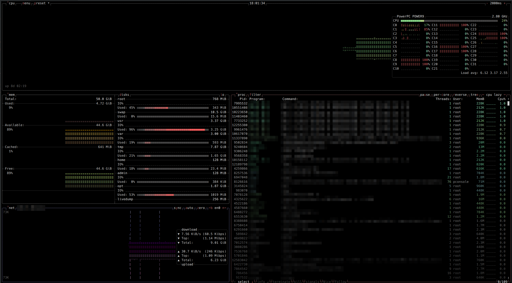

# btop on IBM AIX

This repository holds patches that port [btop](https://github.com/aristocratos/btop), a resource monitor for the
terminal, to IBM AIX. It also offers a ready-to-install package for AIX 6.1 technology level (TL) 7 up to 7.3.

**[AI generated]**: the code in this series was written with the help of an LLM. Every commit subject carries
`[AI generated]`, the marking that the upstream `CONTRIBUTING.md` asks for (section "AI generated code"). The
port is maintained here as a separate line on top of upstream releases.

## What btop shows on AIX

btop shows CPU, load and frequency from libperfstat and follows changes by dynamic LPAR (DLPAR). It also shows
memory and paging space, mounted file systems, the physical volumes (`hdiskN`) with their I/O, network interfaces,
and processes. The kernel `wait` processes are hidden. Per file system I/O needs LVM statistics (`lvmstat -e`).
Inside a workload partition (WPAR) the header shows "WPAR". btop shows no sensors, battery or GPU on AIX.

`btop --mcp-stdio` runs without a terminal and answers MCP clients (Model Context Protocol) with read-only
measurements. An MCP client uses, for example, `ssh <USER>@<HOST> /opt/btop/bin/btop --mcp-stdio` as its server
command. The transport is stdio only. Whoever may start btop on the host gets the data that this user may see.
btop opens no network port. `send_signal` is offered only with `--mcp-allow-signals`. The tools are listed in
[`docs/mcp.md`](https://github.com/mawelo/btop/blob/aix-public/docs/mcp.md) of the fork.

## Find the right document

| Task or question | Document |
|---|---|
| Download, verify and install the package | [docs/install.md](docs/install.md) |
| Which AIX levels a release was tested on, and which files the package installs | [docs/test-matrix.md](docs/test-matrix.md) |
| Why one package runs on AIX 6.1 TL7 to 7.3 | [docs/design.md](docs/design.md) |
| Apply the patches and build btop | [docs/build.md](docs/build.md) |
| What each patch contains, and how the patches affect other platforms | [docs/patches.md](docs/patches.md) |
| Withdrawn releases, and how to report a vulnerability | [SECURITY.md](SECURITY.md) |

## Find the files

| Where | Content |
|---|---|
| [Releases](https://github.com/mawelo/aix-btop/releases) | `btop-<VERSION>-<RELEASE>.aix6.1.ppc.rpm` (signed) and the same tree as `.tar.gz`, with `SHA256SUMS` and `SHA256SUMS.asc` |
| [`aix-public`](https://github.com/mawelo/btop/tree/aix-public) branch of the fork `mawelo/btop` | the patches as commits on top of the upstream base; `btop --version` of the package names a commit of this branch |
| `patches/` | the patch series for `git am`; the base commit is in `patches/BASE-COMMIT.txt` |
| `rpm/` | metadata of the current release (`rpm-info.txt`, `BUILD.txt`, `SHA256SUMS`, `SHA256SUMS.asc`); `rpm/README.md` links to the packages of the [latest release](https://github.com/mawelo/aix-btop/releases/latest) |
| `img/` | screenshot (AIX 7100-05) |
| `KEYS` | public key that signs the RPM and `SHA256SUMS` |

**`v1.4.7-aix1` and `v1.4.7-aix2` are withdrawn**, and `v1.4.7-aix1` to `v1.4.7-aix3` show control characters in
process names. If one of these releases is installed, upgrade to the latest release. [SECURITY.md](SECURITY.md)
gives the details.

## Support and funding

If the AIX port is useful, a donation through [PayPal.me/mawelo](https://paypal.me/mawelo) is welcome.
btop itself is the work of its upstream author, see the "Support and funding" section of the
[upstream README](https://github.com/aristocratos/btop#support-and-funding).

## License

btop is licensed under the Apache License 2.0 (see `LICENSE`). The patches and packaging files in this
repository are published under the same license, with two exceptions that patch 0005 adds unchanged:
Lua 5.4.8 in `libs/lua-5.4.8` (MIT, see `libs/lua-5.4.8/LICENSE`) and nlohmann/json 3.x in
`libs/reuse/json.hpp` (MIT, notice in the file). The package contains both MIT texts in
`/opt/btop/share/doc/btop/THIRD-PARTY-NOTICES.txt`.
